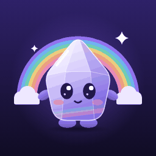
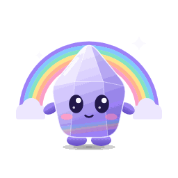
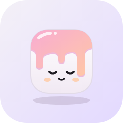
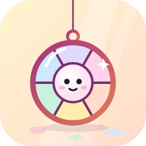

# Glaze mascot: Prism (plus the earlier concepts, fb-1023 D)

## Decision (owner-1101 item 8, 1 Nov 2026): the app icon and mascot are Prism, the little prism creature

 

Owner, 1 Nov: drop the plain diamond prism look and use *"the cute prism creature"* as the app icon direction and the
mascot, with a short cute startup animation; *"people get obsessive over cute shit."*

- **Which creature.** None of the three concept mascots below (Tessel, Latchling, Vitri) is a prism, and the Prism
  picture the owner chose on 25 Oct never reached the repo (see the 25 Oct note below), so there was no drawing to copy.
  Prism was redrawn as the prism creature closest to his description: **a small upright crystal with soft rounded
  facets in lilac glass, a rainbow sheen inside, big glossy eyes with two catchlights, pink blush, a tiny smile, two
  stubby arms and two little feet, standing under a soft rainbow arch (with a cloud at each end) on the deep indigo
  Prism ground, with two sparkles.** If it isn't the creature you picked, say what's different (shape, colours, face)
  and it gets redrawn.
- **App icon** (1024 × 1024, no text, full bleed, opaque): `assets/brand/icon.png` (+ `icon-dark.png`); Android
  adaptive foreground (Prism inside the 66/108 safe zone on `#1C1442`) and a monochrome themed icon (white silhouette,
  face cut out). Same file names as before, so `app.json` did not change. **Needs a new native build** (icons are
  baked in; an over-the-air update can't change them).
- **Mascot**: `assets/brand/mascot.svg` (the same drawing on transparency), preview `docs/mascot/prism-mascot.png`.
- **Splash and opening animation** (`src/ui/IntroGlaze.tsx`, ≤ 1.6 s): the native splash shows Prism **asleep** in its
  tile (eyes closed, no rainbow). The rainbow arch fades in, Prism opens its eyes, floats up a few points and settles
  (one smooth rise and fall), a shimmer crosses its glass, it blinks once and the sparkles appear, then the intro fades
  to the Themes tab as before (same start-up hand-off, `src/core/startupHandoff.ts`). Calm only: sine ease-in-out,
  linear and raised-cosine curves; no springs, bounce, overshoot or size change. Reduce Motion (system or the Glaze
  setting) shows the awake frame at once and simply fades.
- **Files.** Single source of truth: `src/core/introGlaze.ts` (geometry, colours, timings). Rebuild with
  `node scripts/brand/build-brand.mjs && python3 scripts/brand/flatten.py` (Playwright Chromium renders the PNGs;
  flatten.py makes them small palette PNGs: icon about 95 KB, splash about 35 KB, Android about 20 KB). Previews:
  `docs/mascot/prism-icon.svg|png`, `docs/mascot/prism-mascot.svg|png`.
- **Kept for reference:** the plain Prism diamond (25 Oct to 1 Nov) in `docs/mascot/previous-prism-diamond/` and the
  glaze-drip tile before it in `docs/mascot/previous-glaze-drip/`.

## Earlier decision (fb-1025 G, 25 Oct 2026): the app icon is Prism (plain diamond, superseded 1 Nov)

Owner, 25 Oct: *"I like both, but males won't go for the first one, so go Prism; I like it more than the current
Glaze icon."* So:

- The app icon, splash and opening animation became "Prism": a gem-cut triangular crystal seen slightly from
  above, point down, on a deep indigo-to-ink ground, with a beam of light splitting into a fan of six glaze colours.
  Art now in `docs/mascot/previous-prism-diamond/`.
- **Mascots 1 to 3 (Tessel, Latchling, Vitri) are not used.** They stay below as a record.
- **The previous glaze-drip icon** is kept for reference in `docs/mascot/previous-glaze-drip/`.
- The Prism image the owner picked from was not in the repo, so this Prism was redrawn from the concept
  name.

The rest of this page is the original mascot concept note (23 Oct), kept unchanged for the record.

---

Owner idea fb-1023 D ("maybe"): Glaze could have a small, calm, animated companion character,
used as the mascot, possibly as the app icon and as an animated widget, with a few character
options. **This document is concept only.** Nothing in the app, `app.json`, `assets/` or the app
icon has changed. Nothing changes until the owner picks (see the question at the end).

> **Update (23 Oct night):** the app now has its own icon and opening animation: a *faceless* porcelain tile with
> the glaze poured over it (`assets/brand/`, geometry in `src/core/introGlaze.ts`). It borrows Tessel's tile-and-drip
> idea but is not a mascot (no face, no character); the mascot question below is still open and unchanged.
> (Superseded 25 Oct: the icon is now Prism, see the decision at the top.)

All three are drawn from Glaze's own identity: the glaze-drip gradient (`glaze` token
`#F7A8D8 → #FFC9A3`, dark `#B8488F → #E07D55`), porcelain neutrals, the plum tint (`#A2337F`,
`#7A2E6B`), the six pastels (berry, lilac, mint, butter, peach, sky) from `src/core/designV2.ts`,
glass materials, lock screens and light. Each has a different silhouette (rounded tile, padlock,
hanging disc), so they stay distinct at 60 px.

Motion rule for all three (owner preference): calm only. No bouncy springs, no overshoot, no
squash and stretch. Easing is ease-in-out or linear; loops are long (4 to 12 s) and seamless, and
the widget falls back to a still frame when Low Power Mode or Reduce Motion is on.

Previews: `docs/mascot/mascot-N.svg` (240 × 240 widget-sized, also rendered to
`docs/mascot/mascot-N.png` with headless Chromium) and `docs/mascot/mascot-N-icon.svg`
(1024 × 1024 app-icon composition, full bleed; the OS applies its own corner mask).

---

## 1. Tessel

Icon concept: [mascot/mascot-1-icon.svg](mascot/mascot-1-icon.svg)

- **Name.** *Tessel*, from *tessera* (a small glazed tile). Coined for Glaze; not a known
  character name.
- **Look.** A soft rounded porcelain tile (the same squircle family as a Glaze icon tile), white
  to `#F1E9F3`, with a pink-to-peach glaze (`glaze` gradient) poured over its top and running
  down in three uneven drips, a darker `#E58BC3` under-edge for depth and a white gloss streak.
  Closed, content arc eyes, a small smile and peach blush. Sits on a lilac (`#F4F1F7 → #E3D9FF`)
  tile.
- **Personality.** Unhurried and cosy, like a cup cooling on a windowsill. Quietly proud of its
  glaze; thinks every home screen deserves a fresh coat. Never in a rush.
- **Widget animation.** The longest drip slowly lengthens by about 6 % and settles back over 8 s
  (sine ease, no bounce); every third cycle a tiny bead of glaze forms at its tip and fades out.
  The gloss streak drifts across the glaze once every 12 s. Eyes open to dots briefly every 9 s
  (a slow 400 ms blink in reverse: it is a "wake", not a blink). Only the drip path and the
  gloss move; the rest is a static layer.
- **App icon.** At 1024 px the drips and gloss read as glossy ceramic. At 60 px the silhouette
  is a white tile with a pink cap and wavy edge; the icon version sits on a plum
  (`#B8488F → #7A2E6B`) background so the white tile has strong contrast.
- **Variants.** *Berry* (default pink glaze), *Matcha* (mint `#C9F1DE` glaze on porcelain),
  *Midnight* (dark porcelain `#27242C` with the dark glaze `#B8488F → #E07D55`, for dark mode and
  night lock screens).

## 2. Latchling

Icon concept: [mascot/mascot-2-icon.svg](mascot/mascot-2-icon.svg)

- **Name.** *Latchling*, "a small latch". Coined for Glaze; not a known character name.
- **Look.** A frosted-glass padlock: the body is milky glass (white to lilac, high opacity) with a
  bright rim and a gloss streak; the shackle is a thick loop of glaze (`glaze` gradient over a
  `#B8488F` edge). Its keyhole glows warm butter to peach from inside, like a little lamp. Small
  dot eyes with a catchlight and pink blush. Sits on a night lilac (`#352B5C → #1C1A20`) tile with
  a few butter stars and two sparkles.
- **Personality.** A gentle night-watch: keeps your lock screen company and keeps your stuff
  private (Glaze collects no data, and Latchling is the one who'd tell you so). Shy, warm,
  a little sleepy after midnight.
- **Widget animation.** The keyhole glow "breathes": its radius and opacity swell and ease back
  over a 4 s loop. Eyes blink (120 ms close, 160 ms open) every 7 s. Stars twinkle by fading
  opacity on staggered 10 s loops. Optional: on tap (interactive widget) the shackle lifts 4 px
  and lowers again over 1.2 s, eased, no spring.
- **App icon.** The padlock silhouette is the most readable of the three at 60 px: arch plus
  block, warm dot in the middle. At 1024 px the glass rim, gloss and glow carry the "glass"
  material.
- **Variants.** *Dusk* (default peach glow), *Dawn* (butter `#FFEDB0` glow, light sky
  background), *Frost* (sky `#CFE7FF` glass and a cool glow, for blue themes).

## 3. Vitri

Icon concept: [mascot/mascot-3-icon.svg](mascot/mascot-3-icon.svg)

- **Name.** *Vitri*, from *vitreous* (glassy). Coined for Glaze; not a known character name.
- **Look.** A round stained-glass sun-catcher hanging on a thin plum thread from a glazed ring:
  six panes in the six Glaze pastels with plum `#7A2E6B` leading, an outer rim in a plum-to-
  terracotta gradient (`#A2337F → #E07D55`), and a porcelain centre with a small face (dot eyes,
  smile, blush). Soft window light rays fall across a butter-to-peach (`#FFF4CF → #FFDCCB`) tile,
  and the panes cast three coloured light spots below.
- **Personality.** Sunny and curious; loves the moment the light changes. Collects colours from
  every wallpaper you make and hums the palette back to you.
- **Widget animation.** A slow pendulum sway of about ±3° around the thread over 6 s (sine, no
  overshoot); the cast light spots drift in step. A sparkle glints across one pane every 10 s.
  Blink every 8 s. Over the day the panes can tint toward the current theme's palette (one
  colour change per widget timeline entry, not continuous animation).
- **App icon.** At 1024 px the pastel wheel and face are the hero. At 60 px it reads as a pastel
  colour wheel with a ring on top; the face becomes a light dot, which is fine (the wheel shape
  carries it).
- **Variants.** *Daylight* (default six pastels), *Rosette* (berry, peach and butter panes only,
  warm), *Nightglass* (deep pastel fills from dark mode, `#4E2343`, `#352B5C`, `#1C3A5A`, with a
  moon-white centre).

---

## Comparison

| | Tessel | Latchling | Vitri |
| --- | --- | --- | --- |
| Silhouette | Rounded tile with drips | Padlock | Hanging disc on a thread |
| Tie-in | Glaze, ceramic icon tiles | Lock screens, glass, privacy | Light, colour, palettes |
| Widget motion | Slow drip and gloss drift | Breathing glow, blink | Slow sway, glints |
| 60 px icon | Good (on plum) | Best | Good (reads as colour wheel) |
| Battery cost | Lowest (one path) | Low (one opacity/scale) | Low (one rotation) |

## Originality

All three characters, names and previews were drawn from scratch for Glaze as hand-written SVG
(plain shapes and gradients, no traced or reference artwork, no external images, no text). They
are not based on, and are meant not to resemble, any existing character, mascot, brand, game,
film, toy or another app's companion. Generic subjects only: a glazed tile, a padlock, a
sun-catcher. Licence: original artwork, owned by the Glaze project (see `docs/LICENSES.md`).

## Owner question

**Which mascot (1, 2, 3 or none)?**

- **1 (Tessel), 2 (Latchling) or 3 (Vitri):** the chosen character becomes a new animated widget
  kind behind the existing widget adapters (iOS WidgetKit timeline frames, Android Glance / RN
  widget), with its 3 variants as widget options, calm loops only and a still frame under Low
  Power Mode / Reduce Motion. It can also be offered as an *optional* alternate app icon (the
  default icon stays as it is unless you say otherwise), and used in empty states and the
  onboarding header. Each piece would be its own task with tests; the art here is the starting
  point.
- **None:** the concepts stay in `docs/mascot/` as a record and nothing is built.

Nothing changes in the app until you pick.
