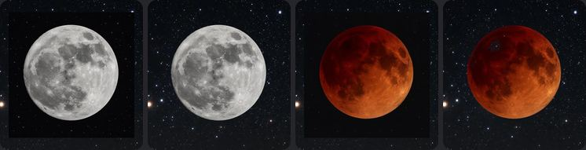

# Widget art blend audit (T251, owner-1101h #2)

Generated by `python3 scripts/packs/blend-audit.py` (Pillow + numpy; maths = `src/core/artBlend.ts`).
Remote packs: `production` release, read from a local cache. Contact sheets were written outside the repo (`/home/claude/contact-sheets`; bundle size guard); this report is the committed record.

**Not device-tested.** The sheets model the phone with the same maths; a native build must confirm.

## Summary (1 Nov 2026, run on glaze-packs-v1 + bundled art)

- **13 themes, 63 pieces** (3 bundled art packs = 9 hero pieces; 10 remote packs = 54 pieces).
  `packs/space-webb` and the 24 catalogue themes have no widget art.
- **Root cause of the owner's two examples** (Alpine Starlight): every remote piece ships OPAQUE
  (1024 px, no alpha) with `"background": "blur"`. The bridge filled the strips beside the fitted art
  with a blurred copy of it, and the widget drew a blurred copy behind everything: a black square
  with a white moon blurs to the light-grey frame; the blood moon's square blurs to the dark box with
  a glow edge. T251 removes both blur paths (bridge + widget + in-app preview).
- **Alpine Starlight (6/6): key.** Plain near-black backgrounds (spread 1-9, 98-100 % uniform). Keyed
  with a soft threshold + un-mix, interior hold (the blood moon's dark limb stays opaque, no stars
  through it), 4 % edge feather. The pieces float on the wallpaper crop: no seam on any size.
- **Other 9 remote packs (48 pieces): feather.** Painted scenes / textured paper to the edge (spread
  13-68): keying would eat the subject, so the edges fade into the wallpaper over 14 % of the side.
  `box` warn (edge > 28 rgb from the wallpaper under the widget, so a hard box if drawn raw):
  cloud-atelier paper-boat, desert-afterglow crescent-moon + solstice-seal, all 5 meadowglow,
  opal-abyss droplet-lighthouse, all 5 rosewater-reverie.
- **Bundled heroes (9/9): already transparent.** No fix needed. Their `halo` flags are the art's own
  painted soft glow round each planet / moon (by design, see the sheets), not a fringe or outline.
- **`halo` on feathered pieces** is scene content inside the fade band (light mist, dark sand), not
  a rim. No `frame`, `outline` or `seam` anywhere after blending.
- **Bundled art fixed in the repo:** none needed (all transparent).

## Decisions

| Theme | Source | Piece | Edge ring (median rgb, spread, uniform) | Decision | Flags |
| --- | --- | --- | --- | --- | --- |
| deep-sea | bundled | hero-small | rgb(0, 0, 0), 0.0, 0.00 | transparent | halo; halo; halo |
| deep-sea | bundled | hero-medium | rgb(0, 0, 0), 0.0, 0.00 | transparent | halo; halo |
| deep-sea | bundled | hero-large | rgb(0, 0, 0), 0.0, 0.00 | transparent | halo |
| starry-night | bundled | hero-small | rgb(0, 0, 0), 0.0, 0.00 | transparent | halo; halo; halo |
| starry-night | bundled | hero-medium | rgb(0, 0, 0), 0.0, 0.00 | transparent | halo; halo |
| starry-night | bundled | hero-large | rgb(0, 0, 0), 0.0, 0.00 | transparent | halo; halo; halo |
| sunset-dunes | bundled | hero-small | rgb(0, 0, 0), 0.0, 0.00 | transparent | halo; halo |
| sunset-dunes | bundled | hero-medium | rgb(0, 0, 0), 0.0, 0.00 | transparent | ok |
| sunset-dunes | bundled | hero-large | rgb(0, 0, 0), 0.0, 0.00 | transparent | halo; halo; halo |
| alpine-starlight | remote | constellation-clock | rgb(2, 2, 4), 9.1, 0.98 | key | halo; halo |
| alpine-starlight | remote | copper-eclipse | rgb(10, 10, 12), 1.1, 1.00 | key | ok |
| alpine-starlight | remote | jupiter-polar | rgb(1, 1, 1), 2.7, 1.00 | key | ok |
| alpine-starlight | remote | saturn-rings | rgb(2, 2, 2), 2.3, 1.00 | key | ok |
| alpine-starlight | remote | silver-moon | rgb(5, 5, 7), 5.1, 1.00 | key | ok |
| alpine-starlight | remote | spiral-galaxy | rgb(3, 3, 4), 3.9, 0.99 | key | ok |
| cloud-atelier | remote | cloud-date | rgb(241, 178, 181), 15.1, 0.56 | feather | ok |
| cloud-atelier | remote | cloud-whale | rgb(247, 185, 183), 21.9, 0.38 | feather | ok |
| cloud-atelier | remote | balloon-skiff | rgb(248, 180, 183), 13.7, 0.60 | feather | ok |
| cloud-atelier | remote | cloud-kite | rgb(243, 178, 181), 13.3, 0.59 | feather | ok |
| cloud-atelier | remote | paper-boat | rgb(225, 167, 186), 21.3, 0.33 | feather | box |
| desert-afterglow | remote | dune-countdown | rgb(57, 29, 32), 29.6, 0.53 | feather | halo |
| desert-afterglow | remote | dunes-photo | rgb(61, 26, 23), 44.7, 0.19 | feather | halo; halo |
| desert-afterglow | remote | crescent-moon | rgb(36, 20, 27), 22.9, 0.70 | feather | box; halo |
| desert-afterglow | remote | desert-scarab | rgb(52, 23, 21), 25.1, 0.58 | feather | halo |
| desert-afterglow | remote | sandstone-arch | rgb(51, 28, 34), 33.1, 0.47 | feather | halo |
| desert-afterglow | remote | pyramid | rgb(47, 24, 26), 33.5, 0.51 | feather | halo |
| desert-afterglow | remote | solstice-seal | rgb(42, 21, 20), 8.1, 0.82 | feather | box; halo |
| firefly-grove | remote | acorn-habits | rgb(17, 20, 7), 19.1, 0.64 | feather | ok |
| firefly-grove | remote | firefly-jar | rgb(8, 11, 5), 14.5, 0.74 | feather | ok |
| firefly-grove | remote | mosswood-door | rgb(10, 16, 9), 18.4, 0.66 | feather | ok |
| firefly-grove | remote | mushroom-lantern | rgb(9, 12, 2), 17.4, 0.72 | feather | ok |
| firefly-grove | remote | sleeping-fox | rgb(19, 22, 5), 26.8, 0.54 | feather | ok |
| indigo-current | remote | harbour-focus | rgb(5, 25, 57), 22.8, 0.78 | feather | ok |
| indigo-current | remote | ink-stingray | rgb(4, 24, 56), 6.9, 0.92 | feather | ok |
| indigo-current | remote | paper-lighthouse | rgb(3, 24, 58), 23.4, 0.83 | feather | ok |
| indigo-current | remote | ink-whale | rgb(4, 22, 53), 17.8, 0.85 | feather | halo; halo |
| indigo-current | remote | paper-harbour | rgb(3, 26, 62), 41.5, 0.62 | feather | halo; halo |
| meadowglow | remote | meadow-date | rgb(239, 225, 191), 62.9, 0.07 | feather | box; halo; halo; halo |
| meadowglow | remote | dew-daisy | rgb(243, 204, 162), 29.4, 0.09 | feather | box |
| meadowglow | remote | dew-grass-orb | rgb(235, 188, 142), 67.9, 0.02 | feather | box; halo; halo; halo |
| meadowglow | remote | sunlit-dandelion | rgb(235, 216, 174), 63.6, 0.06 | feather | box; halo; halo; halo |
| meadowglow | remote | morning-grass | rgb(242, 204, 157), 44.3, 0.08 | feather | box |
| moonpatch | remote | moonpatch-habits | rgb(4, 8, 23), 13.1, 0.75 | feather | ok |
| moonpatch | remote | patchwork-kite | rgb(4, 7, 22), 15.9, 0.71 | feather | ok |
| moonpatch | remote | quilted-rocket | rgb(4, 8, 22), 15.1, 0.71 | feather | ok |
| moonpatch | remote | pocket-rocket | rgb(2, 7, 24), 15.2, 0.72 | feather | ok |
| moonpatch | remote | star-catcher | rgb(2, 7, 25), 15.5, 0.64 | feather | ok |
| opal-abyss | remote | abyss-battery | rgb(4, 27, 56), 49.8, 0.27 | feather | halo; halo |
| opal-abyss | remote | droplet-lighthouse | rgb(7, 35, 69), 44.7, 0.14 | feather | box; halo |
| opal-abyss | remote | moon-jelly-window | rgb(2, 25, 53), 46.5, 0.29 | feather | halo |
| opal-abyss | remote | pearl-shell | rgb(3, 22, 48), 42.6, 0.41 | feather | halo; halo |
| opal-abyss | remote | nautilus | rgb(2, 23, 53), 43.4, 0.32 | feather | halo |
| rainlight | remote | rainlight-date | rgb(9, 7, 12), 43.5, 0.62 | feather | halo |
| rainlight | remote | glass-umbrella | rgb(12, 7, 13), 50.0, 0.56 | feather | halo |
| rainlight | remote | rain-leaf | rgb(5, 4, 8), 23.4, 0.73 | feather | ok |
| rainlight | remote | koi | rgb(5, 5, 12), 38.2, 0.70 | feather | ok |
| rosewater-reverie | remote | rehearsal-countdown | rgb(215, 167, 162), 24.4, 0.40 | feather | box |
| rosewater-reverie | remote | bottled-ballet | rgb(186, 124, 119), 29.7, 0.40 | feather | box |
| rosewater-reverie | remote | glass-rose | rgb(211, 163, 160), 20.4, 0.53 | feather | box |
| rosewater-reverie | remote | pearl-ballet-brooch | rgb(208, 158, 154), 23.9, 0.34 | feather | box |
| rosewater-reverie | remote | satin-swan | rgb(205, 139, 133), 27.4, 0.31 | feather | box |

## Needs the pack release rebuilt (owner chat)

- **alpine-starlight**: constellation-clock (key), copper-eclipse (key), jupiter-polar (key), saturn-rings (key), silver-moon (key), spiral-galaxy (key)
- **cloud-atelier**: cloud-date (feather), cloud-whale (feather), balloon-skiff (feather), cloud-kite (feather), paper-boat (feather)
- **desert-afterglow**: dune-countdown (feather), dunes-photo (feather), crescent-moon (feather), desert-scarab (feather), sandstone-arch (feather), pyramid (feather), solstice-seal (feather)
- **firefly-grove**: acorn-habits (feather), firefly-jar (feather), mosswood-door (feather), mushroom-lantern (feather), sleeping-fox (feather)
- **indigo-current**: harbour-focus (feather), ink-stingray (feather), paper-lighthouse (feather), ink-whale (feather), paper-harbour (feather)
- **meadowglow**: meadow-date (feather), dew-daisy (feather), dew-grass-orb (feather), sunlit-dandelion (feather), morning-grass (feather)
- **moonpatch**: moonpatch-habits (feather), patchwork-kite (feather), quilted-rocket (feather), pocket-rocket (feather), star-catcher (feather)
- **opal-abyss**: abyss-battery (feather), droplet-lighthouse (feather), moon-jelly-window (feather), pearl-shell (feather), nautilus (feather)
- **rainlight**: rainlight-date (feather), glass-umbrella (feather), rain-leaf (feather), koi (feather)
- **rosewater-reverie**: rehearsal-countdown (feather), bottled-ballet (feather), glass-rose (feather), pearl-ballet-brooch (feather), satin-swan (feather)

(The `--fix` PNGs are 1024 px RGBA, about 72 MB for all 54; the pack build re-encodes them to WebP with alpha.)
Run `python3 scripts/packs/blend-audit.py --download --fix <dir>` and ship `<dir>/<theme>/<image>.png` (straight alpha) in place of the opaque widget images (the pack build re-encodes to WebP with alpha and re-hashes), with `"background": "wallpaper"` on each option. Until then a native build with T251 keys / feathers these on the phone at "Use on my widget".

## Flag key

- `box`: opaque background behind the subject (info when it is within 28 rgb of the wallpaper under the widget, warn when farther: a visible box if drawn raw).
- `frame`: the outer ring is flat and differs from the ring inside it (a drawn border).
- `halo`: after blending, faint (alpha < 0.5) pixels covering > 0.4 % of the widget are > 40 luma off the wallpaper under them (a glow or fringe).
- `outline`: a dark fringe round a bright subject.
- `seam` (error): after blending, the widget edge does not match the wallpaper crop.
