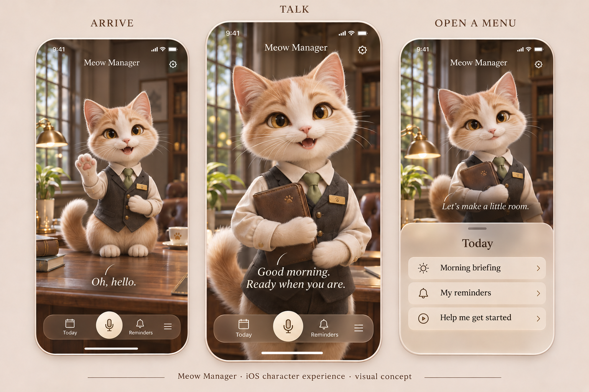

# iOS character experience — 4 November 2026

Jared corrected the first implementation: the app should open into a highly professional kitty that comes to the user, occupies the screen and feels like a living companion with menus. The dashboard prototype is set aside. **iOS is the current product target.** Jared liked the visual direction, then specified a different activity on each fresh opening, including waking curled up and eating chips. This brief records the experience; the master atlas Meow Manager row remains the only roadmap. The general direction is accepted; the exact production model and room remain to be developed.

This is an AI-generated static art-direction study. It is not a running iOS screen, an animation, a rigged 3D model or proof of native rendering quality. Jared spotted an extra limb in the first version; v2 uses an unambiguous seated four-paw greeting. The original is retained as superseded reference. The original prompt and the exact built-in imagegen edit prompt are saved in `character-direction/CONCEPT_PROMPT.txt` and `character-direction/CONCEPT_EDIT_FOUR_PAWS.txt`.

## The opening moment

The screen is a small world. Each fresh opening finds the kitty doing something different. It notices the user, wraps up its activity and becomes the attentive assistant. A short greeting combines eye contact, ears, posture, tail movement and a voice/caption. Its professional composure has a little comic contrast with its private cat habits. The user can speak or open a menu immediately; the arrival never locks out controls. A quick background/foreground switch continues the current interaction rather than restarting a scene during a task.

### Varied opening scenes

Jared's explicit examples are the first two below. The others are proposed variations in the same spirit.

| Opening | The little reveal | Transition into help |
|---|---|---|
| Curled-up nap | Tail over nose, one ear reacts, one eye opens | Uncurls, stretches, tidies waistcoat and looks up. |
| Bag of chips | Sneaking a chip, caught mid-crunch | Pauses, puts the plain unbranded bag away, brushes off a crumb and becomes professionally attentive. |
| Desk preparation | Carefully arranging the folio and pencils | Notices the user, closes the folio and comes forward. |
| Lost pen | Peering underneath the desk | Emerges with the pen, looks pleased and acknowledges the user. |
| Getting ready | Concentrating on a slightly crooked tie | Gives it one last adjustment and greets the user. |
| Cat distraction | Briefly absorbed by its own moving tail | Catches itself, composes its posture and turns toward the user. |

The effect is that the user has walked in on its day. A scene includes a small beginning, recognition and recovery into the same assistant-ready state. Surprise comes from situations and acting; professional competence returns as soon as help is needed.

The proposed selector uses a persisted shuffle bag of authored scene clips with no immediate repeat. Context such as time of day may weight choices, while retaining variety. Quick returns and pending confirmations resume their existing state. A user can interrupt immediately by talking or tapping; the scene smoothly settles into listening or a menu-ready pose. Voice/captions and reduced-motion support apply to every scene. A new vignette never resets the person's tasks or conversation.

The animation library is authored and shipped with the character assets. New AI image/video generation at app launch is outside this design. Actual scene selection, character assets, transitions and animation playback are not implemented yet.

On a first visit the greeting is an introduction. On a later visit the cat can offer a relevant briefing only from information actually available: an upcoming appointment, an overdue reminder or a task the user asked to revisit. Without that information it asks how it can help. It never invents what it knows about the person's day.

## The cat is the home screen

The proposed character is a distinctive cream/caramel kitty in a tailored waistcoat, with an understated tie and a small folio. Its professional quality comes from competent acting, materials, animation, lighting, voice and useful assistance. Clothing alone will not establish the experience. The concept uses a warm, carefully arranged office; that room and the character styling remain reviewable choices.

The cat occupies most of the screen. The camera and interface respond to its position. A quiet dock offers Today, Talk, Reminders and Menu. Planning, task editing and settings open as native sheets over the room. The cat stays in view, looks toward the sheet or moves aside. Returning to the room feels continuous. Large task lists do not define the first view.

## Conversation has visible acting

| Moment | Acting | Functional behaviour |
|---|---|---|
| Arrival | A varied activity, recognition, then recovery into professional attention | Persisted no-repeat scene selection, immediate interruption and a shared ready state. |
| Idle | Subtle breathing, occasional blink, ear and tail reactions | Quiet and unobtrusive. Stop unnecessary animation when backgrounded. |
| Listening | Turns toward user, attentive eyes, small nod | Visible microphone state, explicit push-to-talk initially, editable transcript and a text alternative. |
| Thinking | Glances at folio or desk, considers | Shows real pending work. A cancellable action has a cancel control. |
| Speaking | Mouth shapes, brows, gaze and gestures coordinated with voice | Readable captions, replay/mute and speech interruption. No compulsory audio. |
| Offering help | Presents a suggestion, points toward a sheet | Clear proposed task/time/action, editable before a consequential change. |
| Task completed | Brief pleased reaction and a professional acknowledgement | Confirms the actual saved result. |
| Action unavailable | Honest, composed reaction | Explains the failed or unsupported action and offers a useful alternative. |

These states need authored transitions. Replacing a drawing with a large static render or a loop of a bobbing image would not establish the intended character interaction.

## What a useful session feels like

The user opens the app and says, “Tomorrow is a mess. Help me sort it.” The cat listens, checks connected calendar/task information, asks only for a missing fact that matters, and presents a manageable day in a sheet. If asked to book something, it shows the exact proposed action and reports only what a real connector confirms. After the sheet closes, the cat remains there and carries the context of the conversation. The personality connects the assistance into one experience.

Touch reactions, a little humour and an evolving relationship add charm. Essential assistance stays immediate. Hunger, damage, forced mini-games and penalties for time away are outside the current direction. English and Japanese remain desired language support, with fluent-user review still needed.

## Production implications

The next design proof is a short iPhone character scene with at least two different openings (nap and chips), a shared idle, tap reaction, attentive listening, voiced response with captions and a menu opening while the cat remains present. The proof must demonstrate repeat avoidance and interruption. Character acting and continuity are the acceptance criteria before expanding the task screens. This is the current next step in the master roadmap, not a second build schedule.

Anatomy review is an explicit asset check: two forelegs, two hind legs, one tail, consistent shoulder/hip attachment and no duplicate paws through motion, occlusion or props. The corrected image is a visual reference; the rig and every authored clip need their own review.

A genuine 3D direction requires an original model, textures/materials, a body/face rig, authored clips and a tested rendering path. The image here supplies visual direction only. A technical spike must establish iPhone performance, asset size, loading, voice/animation coordination, interruption and reduced-motion behaviour before committing to a renderer. Existing storage and planning logic can be reused after the character experience works. The current App Factory repository, signing and TestFlight infrastructure can remain the release route; the new presentation layer has not been chosen or built.

Technical references checked for possible approaches: [Apple RealityKit](https://developer.apple.com/documentation/realitykit) and [Rive's Apple runtime](https://rive.app/docs/runtimes/apple/apple). These are candidates for evaluation, not integrated dependencies or a promise that either supplies the character assets.
